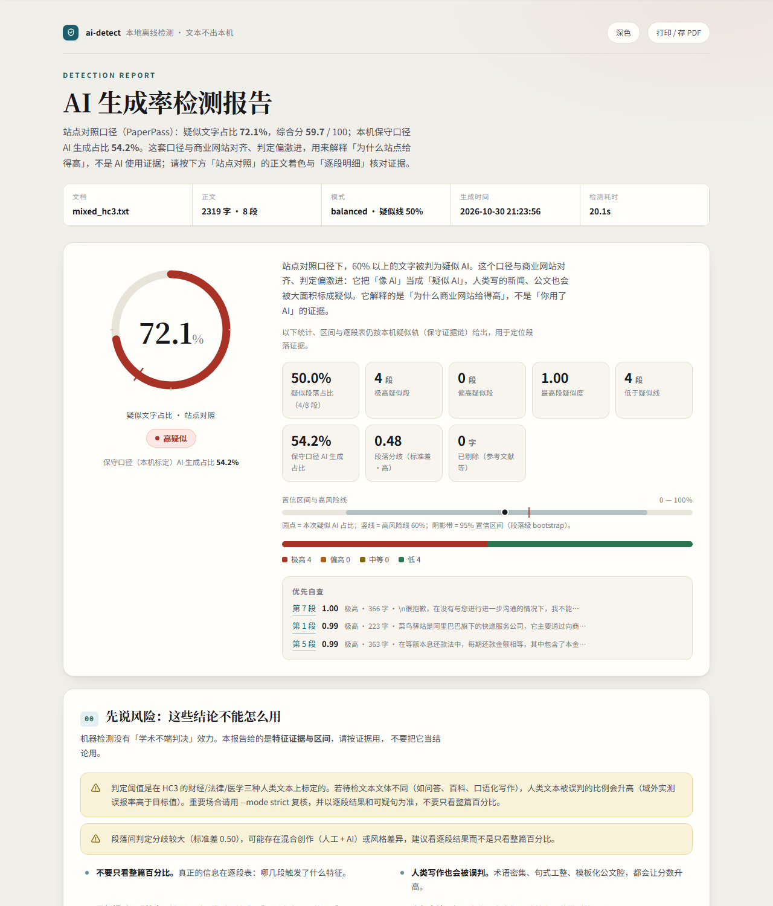

# ai-detect

**纯本地、离线、可解释的中文「AI 生成率」自查工具。** 两个判别器 + 困惑度 + 文体统计共四个信号源、两条汇总轨道（疑似 AI 占比 / 保守口径 AI 生成占比，含 95% 置信区间）与段落级证据，并生成一份可离线打开的单文件 HTML 报告。

- 版本 1.0.0 ｜ Python ≥ 3.10 ｜ 纯 CPU 可跑 ｜ 除首次下载资源外零网络
- 交付形态：命令行（`python -m aidetect ...`，安装后也可直接用 `aidetect`）+ 单文件 HTML 报告 + 机器可读 JSON；不想敲命令时双击 `启动检测.bat`，把文档拖进窗口即可（见§二「不想敲命令？用启动器」）。

> **定位一句话**：这是一个**写作自查工具**，不是检测判决系统。它回答的是「哪几段像 AI、为什么、这个百分比的不确定性有多大」，而不是「你有没有学术不端」。

## 目录

- [一、它是什么，不是什么](#一它是什么不是什么)
- [二、快速开始](#二快速开始)
- [三、输出说明](#三输出说明)
- [四、原理](#四原理)
- [五、评测结果与指标解读](#五评测结果与指标解读)
- [六、局限与误判护栏](#六局限与误判护栏)
- [七、离线与隐私](#七离线与隐私)
- [八、目录结构](#八目录结构)
- [九、FAQ](#九faq)
- [十、开发、测试与复现](#十开发测试与复现)
- [十一、许可、致谢与相关文档](#十一许可致谢与相关文档)

## 一、它是什么，不是什么

ai-detect 把一篇中文文档切成「判定单元」，用三个互相独立的信号给每个单元打一个 0–1 的 P(AI)（越大越像模型生成），再把单元分数汇总成整篇结论，并把每个分数背后的证据摊开给人看。所有计算都在本机完成，文本不上传。

### 适用场景

| 场景 | 用法 |
| --- | --- |
| 论文 / 报告 / 稿件的**投稿前自查** | 看清哪几段被标红、触发了什么特征，优先改写「极高」「偏高」段落 |
| **改写前后的相对比较** | 同一工具、同一模式跑两次，看整篇占比与逐段明细是否下降（比绝对数字更有意义） |
| 编辑部 / 课题组的**人工复核初筛** | 用 `json` 子命令批量出结构化结果，再由人看原文判断，不直接下结论 |
| 方法演示与教学 | 四引擎、两条汇总轨道、融合权重、阈值与置信区间全部可解释、可复现 |

### 明确不适用

- **不能作为学术不端认定或指控证据**。它输出的是特征证据与区间，不是作者归属判定，也没有任何机构的检测效力（详见 [FAQ](#九faq)）。
- **不能和知网 / 维普 / Turnitin 等商业系统的百分比对照**。它们的模型、语料、阈值都不公开，彼此结论也常有分歧；本工具的数字只在本工具口径内有意义。
- 不适合把「整篇是不是 AI 写的」当作二选一结论；本工具给的是连续分数、区间和段落证据。
- 不适合以非中文为主、诗歌 / 代码 / 公式 / 大段表格为主的文本；扫描版 PDF（无文本层）、正文不足 300 字的短文本结论不可靠。
- 不判断抄袭、篡改、署名归属，也不区分「AI 生成」「AI 润色」「机器翻译」这几类来源。
- 对**最新一代模型**（GPT-4 级以后、DeepSeek 等）的文本，「没测出来」不等于「不是 AI 写的」——检测器对训练分布内的旧模型文本更敏感（见第六节「时代偏移」）。

## 二、快速开始

### 环境要求

- Python ≥ 3.10（本项目在 3.12 上开发和验证）
- 磁盘：四个模型合计约 1.6 GB；标定用的评测语料另约 21.7 MB
- CPU 即可运行，**不要求 GPU**（代码按 CPU 推理设计，有 GPU 也不会启用）
- 读 Word / PDF 需要可选依赖：`python-docx`、`pypdf`（PyMuPDF 作为 PDF 兜底）

以下命令均在**项目根目录**（`ai-detect/`）下执行。

### 首次安装与运行

```powershell
cd ai-detect

# 1)  editable 安装（要读 .docx / .pdf 时带上 extras）
python -m pip install -e ".[docx,pdf]"

# 2) 自检：缺什么会直接打印下一步该跑的命令
python -m aidetect doctor

# 3) 首次下载资源（clf + cmj + zhv3 + ppl + hc3zh），这是唯一联网的命令
python -m aidetect fetch all

# 4) 标定融合参数并做域外评测
python -m aidetect calibrate

# 5) 检测一篇文档并自动打开报告（Windows）
python -m aidetect report 你的论文.docx --open
```

几点说明：

- 推荐用 `-e` 可编辑安装：模型、语料、输出默认都落在项目目录下。若用非可编辑安装，请设置 `AIDETECT_HOME` 指向可写目录（见[环境变量](#环境变量)）。
- 第 2 步 `doctor` 在尚未下载模型 / 尚未标定时**退出码为 1** 并给出补齐命令，这是正常流程，不是崩溃。全部就绪后退出码为 0。
- 只做检测可以只跑 `python -m aidetect fetch`（默认 `clf` + `cmj` + `zhv3` + `ppl`，不下载评测语料）；要标定 / 复评才需要 `hc3zh`。`zhv3` 只服务「站点对照」轨道（见 [3.3](#33-四个数字分别回答不同问题重要)），不下也能检测，只是报告里没有站点对照数字。
- `calibrate` 需要 `clf`/`cmj`/`ppl`/`hc3zh` 四类资源齐全，会生成 `aidetect/resources/calibration.json` 与 `eval/report.md`。`--limit 300` 只用于快速调试，**正式阈值请全量运行**；之后可用 `bench --limit 300` 在同一 test 子集上复评（不重训）。
- 每个子命令都支持 `--help`（如 `python -m aidetect fetch --help`）；`fetch` 另可用 `--workers` / `--chunk-mb` / `--retries` 调整下载并发、分片大小与重试次数（默认 8 / 16 / 200）。
- `--open` 仅在 Windows 下调用系统默认浏览器；其他平台会静默跳过，手动打开生成的 HTML 即可。

### 不想敲命令？用启动器（双击 / 拖拽）

资源下载好之后（`python -m aidetect fetch all`），日常检测可以完全不碰命令行：

1. 双击项目根目录的 **`启动检测.bat`**（等价于 `python -m aidetect launch`），打开一个交互窗口；
2. 把 `.docx` / `.pdf` / `.txt` / `.md` 文件**拖进这个窗口**，按回车；
3. 也可以把文件直接**拖到 `启动检测.bat` 的图标上**，或一次拖多个 / 拖一个文件夹（文件夹会展开成其中的所有文档）。

窗口里可以：

- 输入 `1` / `2` / `3` 切换 `balanced` / `strict` / `lenient` 三档严格程度（切换后对本会话后续文档生效）；
- 模型只在第一次检测时加载一次，同一窗口里连续检测多篇不会重复等这 10 秒左右；
- 报告生成后自动用默认浏览器打开（`AIDETECT_NO_OPEN=1` 可关掉），HTML/JSON 落在 `out/`；
- 输入 `h` 看帮助，`q`、`exit` 或直接回车退出。

想放到桌面：右键 `启动检测.bat` → **发送到 → 桌面快捷方式**（可重命名成「AI 生成率检测」），之后双击桌面图标即可；把文档拖到这个快捷方式上同样能检测。启动器在缺模型 / 缺依赖时会直接提示该跑的 `doctor`、`fetch` 命令，不会闪退（窗口会停住等你按任意键）。

### 资源下载地址（大文件不随仓库分发）


本仓库只包含代码、文档、测试与评测证据。四个模型权重与评测语料合计约 **1.6 GB**，**不入库**，请用 `python -m aidetect fetch all` 下载（唯一联网命令，多连接断点续传；HF 主站失败自动回退 `hf-mirror.com`，`cmj` 模型走 ModelScope）。若 Q 网不好想手动下，按下面的上游地址取文件、按「放置位置」放好后用 `python -m aidetect doctor` 校验即可（`fetch` 也会跳过已存在且大小正确的文件）。

| 资源 | 用途 | 体积 | 上游地址 | 放置位置（默认在项目根目录下） |
| --- | --- | --- | --- | --- |
| `Hello-SimpleAI/chatgpt-detector-roberta-chinese` | AI 文本判别器 v1（HC3-Chinese 微调，保守口径） | 390.2 MB（6 个文件） | <https://huggingface.co/Hello-SimpleAI/chatgpt-detector-roberta-chinese> | `models/clf/`：`config.json`、`pytorch_model.bin`、`vocab.txt`、`tokenizer.json`、`tokenizer_config.json`、`special_tokens_map.json` |
| `mokawa3018/cmj-chinese-aigc-text-detector` | AI 文本判别器 v2（zhv3 微调，首屏疑似度用这个） | 390.2 MB（6 个文件） | <https://huggingface.co/mokawa3018/cmj-chinese-aigc-text-detector> ／ <https://modelscope.cn/models/mokawa3018/cmj-chinese-aigc-text-detector> | `models/cmj/`：同上六个文件 |
| `yuchuantian/AIGC_detector_zhv3` | AI 文本判别器 v3（站点对照轨，更敏感） | 390.2 MB（5 个文件） | <https://huggingface.co/yuchuantian/AIGC_detector_zhv3> | `models/zhv3/`：`config.json`、`pytorch_model.bin`、`vocab.txt`、`tokenizer_config.json`、`special_tokens_map.json` |
| `uer/gpt2-chinese-cluecorpussmall` | 困惑度 / GLTR 引擎（GPT2-Chinese） | 401.4 MB（5 个文件） | <https://huggingface.co/uer/gpt2-chinese-cluecorpussmall> | `models/ppl/`：`config.json`、`pytorch_model.bin`、`vocab.txt`、`tokenizer_config.json`、`special_tokens_map.json` |
| `Hello-SimpleAI/HC3-Chinese` | 标定 + 域外评测语料 | 20.7 MB（1 个文件） | <https://huggingface.co/datasets/Hello-SimpleAI/HC3-Chinese> | `data/hc3zh/all.jsonl` |

直链格式：HF 模型 `https://huggingface.co/<repo>/resolve/main/<file>`，HF 数据集 `https://huggingface.co/datasets/<repo>/resolve/main/all.jsonl`，ModelScope 模型 `https://modelscope.cn/api/v1/models/<repo>/repo?Revision=master&FilePath=<file>`（仓库体积里还含 `flax_model.msgpack`、`tf_model.h5` 等各 400MB 的副本，**不需要下载**）。

- 只做检测不需要评测语料：`python -m aidetect fetch`（默认只下 `clf` + `cmj` + `zhv3` + `ppl`）。
- 可选实验组件：`python -m aidetect fetch qwen`（Qwen2.5-0.5B，约 950 MB，用于后续「现代 LM 困惑度」实验，**当前主链路不使用**；下载了也不影响检测速度）。
- 许可：四个模型按其模型卡片声明的许可使用（三个判别器均为 Apache-2.0，GPT2-Chinese 见其卡片），语料遵循 HC3-Chinese 仓库声明；这些资源**不适用**本仓库的 MIT 许可，且不随仓库分发。详见 [THIRD_PARTY_NOTICES.md](THIRD_PARTY_NOTICES.md)。

### 常用命令速查

| 命令 | 作用 |
| --- | --- |
| `python -m aidetect doctor` | 自检环境、依赖、模型、标定、评测语料；不联网，会探测 `out/` 可写性 |
| `python -m aidetect fetch [clf\|cmj\|ppl\|hc3zh\|all]` | 下载模型 / 评测语料，支持断点续传（唯一联网命令） |
| `python -m aidetect calibrate [--limit N]` | 用 HC3-Chinese 拟合融合参数，产出标定文件与 `eval/report.md` |
| `python -m aidetect bench [--limit N]` | 不重新拟合，用现有 `calibration.json` 复评；`--limit N` 复现与 `calibrate --limit N` 相同的 test 子集（本机 `--limit 150` 实测复评 1417 个 test 单元、约 566 秒；与标定时指标最大绝对差 0.0032，属阈值边界敏感差异，见 `eval/report.md`）；无标定文件时退出码 3 |
| `python -m aidetect report <文件> [...]` | 检测文档，产出 HTML + JSON 报告 |
| `python -m aidetect launch [文件...]` | 交互式启动器：拖文件进来即可检测；也是 `启动检测.bat` 调用的入口 |
| `python -m aidetect json <文件> [--out 路径]` | 只输出 JSON（便于脚本化 / 批量） |
| `python -m aidetect --version` | 打印版本号 |

### report / json 参数

| 参数 | 取值 | 说明 |
| --- | --- | --- |
| `file` | `txt` / `md` / `docx` / `pdf` 路径，或 `-` | `-` 表示从标准输入读（管道编码需为 UTF-8） |
| `--mode` | `strict` / `balanced` / `lenient` | 严格程度，默认 `balanced`；越严格误伤人越少、漏检越多 |
| `--out-dir` | 目录路径 | 输出目录；默认 `AIDETECT_HOME/out/`（可编辑安装即项目下的 `out/`），显式相对路径按当前工作目录解析 |
| `--max-sentences` | 整数，默认 20 | 报告里最多列出的可疑句数 |
| `--no-html` / `--no-json` | 开关 | 跳过某一种产物 |
| `--open` | 开关 | 生成后用默认浏览器打开 HTML（Windows） |
| `json --out` | 文件路径 | 把 JSON 写入文件而不是打印到终端 |

示例：

```powershell
python -m aidetect report 论文.docx --mode strict --out-dir .\out
python -m aidetect report 论文.docx --no-html --no-json   # 只在终端看摘要
python -m aidetect json 初稿.md --out .\out\初稿.json
```

批量处理示例（PowerShell；每篇一个进程，重复加载模型，按需使用）：

```powershell
Get-ChildItem .\papers\*.docx | ForEach-Object {
  python -m aidetect json $_.FullName --out ".\out\$($_.BaseName)_report.json"
}
```

### 退出码

| 退出码 | 含义 | 常见触发 |
| --- | --- | --- |
| `0` | 成功 | 命令正常完成 |
| `1` | 自检发现缺失项 / 下载未完成 | `doctor` 缺模型或标定；`fetch` 有文件失败（重跑同一命令可续传） |
| `2` | 输入不可用 | `report` 文件不存在、格式不支持、正文为空 |
| `3` | 资源缺失 | `report`/`json` 缺模型；`bench` 缺标定文件；`calibrate` 资源不齐 |
| `4` | 未预期的内部错误 | 设 `AIDETECT_DEBUG=1` 可看完整堆栈 |
| `130` | 用户按 Ctrl-C 中断 | — |

### 环境变量

| 变量 | 作用 | 默认值 |
| --- | --- | --- |
| `AIDETECT_HOME` | 模型 / 语料 / 输出根目录（`models/`、`data/`、`out/` 都在其下） | 项目根目录 |
| `AIDETECT_THREADS` | torch 的 CPU 线程数 | 自动（最多 8） |
| `HF_ENDPOINT` | 模型与语料下载端点 | `https://huggingface.co`（失败自动回退 `hf-mirror.com`） |
| `AIDETECT_DEBUG` | 出错时打印完整堆栈 | 关闭 |

## 三、输出说明

### 3.1 生成的文件

默认写入项目下的 `out/`：

| 文件 | 内容 |
| --- | --- |
| `out/<文档名>_report.html` | 单文件 HTML 报告（样式与脚本全部内联，无外部资源，可离线打开 / 直接打印或另存 PDF / 直接发给别人） |
| `out/<文档名>_report.json` | 机器可读结果（含逐段原文与各引擎信息，便于批处理和二次分析） |

用 `--out-dir` 改输出目录，用 `--no-html` / `--no-json` 关掉某一种产物。终端还会打印一段摘要：正文与剔除字数、各引擎状态、两种口径的 AI 率与置信区间、模式与阈值、护栏提示、产物路径、总耗时。

`<文档名>` 取源文件名主干（`<>:"/\|?*` 等非法字符替换为 `_`）；从标准输入（`-`）读取时产物名固定为 `stdin_report.html` / `stdin_report.json`。

### 3.2 HTML 报告怎么读



| 区块 | 内容 | 用法 |
| --- | --- | --- |
| 首屏结论 | 环形量表（**疑似文字占比 · 站点对照**，站点轨可用时）+ 综合分、档位、95% 置信区间与高风险线，旁边小字是**保守口径 AI 生成占比**；下方统计格：疑似段落占比、极高 / 偏高疑似段数、**最高段疑似度**、**低于疑似线段数**、段落分歧、已剔除字数、等级分布条、优先自查 Top3 | 先看结论与区间，**不要只看那个百分比**；和商业网站对比看「站点对照」 |
| 先说风险 | 报告的静态使用边界 + 本次触发的护栏提示 | 从「这些结论不能怎么用」入手 |
| 01 站点对照 · 全文按句着色 | 站点口径的疑似文字占比 + 极高 / 偏高 / 中等 / 无 AI 疑似四档占比 + 判别器名 + 口径来源；正文按句着色（红 = 高、橙 = 偏高、黄 = 中等、灰 = 未检测），底部折叠列出前 60 条句子分数 | 这是最接近商业网站报告的那一屏；先看红/橙句落在哪 |
| 02 段落分布 | 每根柱子 = 一个判定单元的**疑似度**（v2 判别器 P(AI)，柱顶标数值），虚线 = 当前模式疑似线，颜色 = 四档；横轴段号与「04 逐段明细」的行锚点一致 | 快速定位哪几段「突出来」，点段号可跳转 |
| 03 可疑句 | 只对已判为疑似的单元做句级细化（v3 / v2 判别器），按分数降序，默认先列 8 条、其余折叠，最多 `--max-sentences` 条 | 优先改写的位置 |
| 04 逐段明细 | 段落序号 / 类型 / 字数 / **疑似度** + 热力条 / 档位 / **保守 P(AI)** / 摘要 + 「展开全文 / 判定依据」；顶部可按档位筛选 | 逐条核对原文与触发特征；标题与参考文献等标「未纳入」 |
| 05 引擎与标定 | 四引擎 + 站点轨判别器的状态 / 平均分 / 耗时 / 说明、标定版本与当前模式的域外 Acc·AUC·FPR、**各口径的定义**、改写建议 | 核对这次结果是用哪套参数算的 |
| 页脚 | 复现命令 + 参数指纹 | 存档时一并保留，便于日后对比 |

没有站点轨数据（未下载 `zhv3`）时，01 站点对照整块消失，编号自动回退为 00 护栏 → 01 段落分布 → 02 可疑句 → 03 逐段明细 → 04 引擎，首屏大字也回退为「疑似 AI 占比」。

报告顶部有三个交互（都只在本机运行，报告仍是一个可离线打开的 HTML 文件）：

- **深色 / 浅色切换**：默认浅色（适合打印与存档），点按后记住选择（存在浏览器 localStorage）；
- **打印 / 存 PDF**：走专门的 A4 打印样式，隐藏交互按钮与折叠区，保留颜色；
- **段落筛选**：在「03 逐段明细」按 极高 / 偏高 / 中等 / 低 / 未纳入 过滤，右侧显示「显示 N / 共 M 段」。

### 3.3 四个数字，分别回答不同问题（重要）

报告里同时给出四个数字，**它们不是同一个东西**，看哪一个取决于你要回答什么问题：

| 数字 | 定义 | 是否随 `--mode` 变化 | 适合回答 |
| --- | --- | --- | --- |
| **疑似文字占比 · 站点对照**（首屏大字，站点轨可用时） | 全文按句交给 v3 判别器（`zhv3`）打分 → 用 `resources/site_map.json` 的分数映射换成站点口径的 0–100 分 → 分数 ≥ **70 / 60 / 50** 的句子分别算极高 / 偏高 / 中等疑似，据此统计**字数占比** | 不随 `--mode` 变（站点口径固定） | 「**老师 / 商业网站大概会给我打多少**」——见 [4.7](#47-站点对照轨怎么和商业网站对齐) 与 [5.6](#56-站点对照轨的验证) |
| **疑似 AI 占比** | 疑似度 ≥ 疑似线的判定单元**字数** ÷ 正文字数。疑似度来自 v2 判别器（`cmj`）对每个单元的原始 P(AI) | **变**（疑似线：strict 70% / balanced 50% / lenient 35%） | 「按本机固定疑似线，大概有多少文本会被标成 AI」 |
| **保守口径 AI 生成占比** | Σ(判定单元字数 × 融合 P(AI)) ÷ 正文总字数。融合分经 HC3 标定，阈值很小（约 0.7%，见第五节） | 数值本身不变（连续期望值），但段落判定随阈值变 | 「**能不能坐实**：有多少文本能被严格口径明确判定为机器生成」 |
| **疑似段落占比** | 疑似度 ≥ 疑似线的判定单元数 ÷ 判定单元总数 | **变**（同上） | 「有多少段落需要我逐段去看/改」 |

为什么要有四条轨道：

1. **站点对照轨偏激进**。它直接对齐商业网站的口径：商业检测把「像 AI 写的」大幅标红，人类写的新闻、公文也会被大面积标成疑似。它解决的是「为什么老师那边给我 60%+，你这里 0.0%」这个问题，**不是**「你有多少文字一定是 AI 生成」——它的档位线（70/60/50 分）是用 PaperPass 免费版报告在锚点论文上的公开数字反解的，见 [4.7](#47-站点对照轨怎么和商业网站对齐)。**人类正式文本在这条轨道上误报很高**（实测 63.6% / 69.3%，见 5.6），所以它只能回答「大概会被打多少分」，不能当证据。
2. **保守口径偏保守**。它的标定目标是把误报压到很低（`balanced` 目标 5% FPR），而训练/标定语料是 GPT-3.5 时代的中文问答（HC3）。如果 AI 文本是较新模型生成、或经过人工改写，保守口径会明显**漏检**——这正是 v1.0 出现「网站 70%、本工具 0.0%」的原因。
3. **疑似口径更敏感**。v2 判别器（`cmj-chinese-aigc-text-detector`，由 zhv3 在跨 5 个模型家族的 1:1 平衡语料上微调）对较新模型的输出更敏感；代价是它也会把一部分人类文本标成疑似（域外 FPR 见 5.1 节，比 v1 高）。
4. **数字之间差得越远，越说明这篇文本处在灰度区**：保守口径很低（比如 0.1%）但站点对照很高（比如 68%），意味着「在你的语料上它有大量现代模型 / 规整文体的特征，但没强到能被严格口径坐实」——这种情况请不要拿保守口径当「没问题」的证据，也不要拿站点对照当「有罪」的证据，去逐段看。

另有两个容易混淆的口径细节：

- **判定单元不等于文章自然段**。短于 24 字的段落会与相邻段合并，超长段落会在句子边界拆开，所以「段」的数量和 Word 里看到的段落数可能不同。
- **字数口径不是「判为 AI 的字数」**（这一条只适用于保守口径）。保守口径里一段 P(AI)=0.85 的文字会以 85% 的权重计入；疑似口径是「过线就整段算作疑似」；站点对照轨是按**句子**判定后统计字数占比，与段落无关。

举例（纯示意，非实测）：10 个等长单元里 2 个疑似度 0.95、8 个 0.05，`balanced` 疑似线 50% 下疑似占比 20%、疑似段落占比 20%；同样这批分数在保守口径下可能只算出 2% 左右。

### 3.4 疑似占比四档

首屏的档位：站点轨可用时按**站点疑似占比**（`config.SHARE_GRADES`：≥60% 高 / ≥40% 中高 / ≥20% 中 / 其余低），否则按**疑似 AI 占比**给，都与 `--mode` 的疑似线无关：

| 档位 | 疑似占比 | 报告结论 | 建议动作 |
| --- | --- | --- | --- |
| 低 | < 20% | 疑似 AI 特征不明显 | 无需处理 |
| 中 | 20% – 40% | 存在少量 AI 特征 | 抽查逐段表，确认是否局部段落被 AI 辅助 |
| 中高（偏高） | 40% – 60% | AI 特征明显，建议逐段自查 | 按逐段表定位并改写可疑段落 |
| 高（极高） | ≥ 60% | AI 特征强，风险高 | 按逐段明细找到「极高」段落，逐段核对后用你自己的表达改写，再重跑对比 |

模式口诀：`strict` 疑似线最高（70%，宁可漏检，少冤枉人），`balanced` 折中（50%，默认），`lenient` 疑似线最低（35%，宁可多看几段，更接近商业网站那种「宁可标出来」的风格）。**和网站结果差得多时，先用 `--mode lenient` 复核**，再看逐段证据。

### 3.5 置信区间

报告里的 `95% CI` 是**单元层面 bootstrap 1000 次**（固定随机种子，结果可复现）得到的：每次有放回地重采样判定单元，重新计算「疑似 AI 占比」与「保守口径 AI 生成占比」，取 2.5% 与 97.5% 分位数。两条轨道各有一组区间；首屏展示的是疑似占比的区间。

- 它反映的是「段落间判定分歧」带来的不确定性，**不是模型准确率的区间**。
- 单元少于 3 个时不给区间（显示「样本不足」）。
- 区间越宽，通常意味着各段风格差异大 / 混合创作 / 文本太短，此时更应该看逐段证据而不是整篇数字。

### 3.6 可疑句

只对「已判为 AI」的单元做句级细化：句子级 P(AI) ≥ max(0.70, θ) 才会列出，按分数降序取前 N 条（`--max-sentences`，默认 20）。过短的句子（<20 字）会先与相邻句拼接再判定，避免分布外误判。判别引擎不可用时，报告会明确说明「仅按段落分推定」。

### 3.7 护栏提示

报告会用黄色提示框列出本次触发的风险与固定提醒（`warnings` 字段同样写进 JSON）：

| 触发条件 | 含义 | 建议 |
| --- | --- | --- |
| 正文 < 300 字 | 低于可靠性下限，判定波动大 | 补充文本后再测，不要下结论 |
| 未找到 `calibration.json` | 正在用启发式加权，不是标定参数 | 先跑 `python -m aidetect calibrate`；此状态的分数只能相对比较 |
| 某个引擎不可用 | 已降级运行（例如模型文件缺失） | 按提示补 `fetch`，或明确接受可靠性下降 |
| 已剔除的参考文献 / 元信息占全文 > 25% | 正文样本偏少，结论代表性有限 | 检查文档切分是否正常，或换用更完整的正文 |
| 段落 P(AI) 标准差 > 0.28（≥ 5 个单元时） | 段落间分歧大，可能存在人工 + AI 混合创作或风格差异 | 看逐段结果，不要只看整篇百分比 |
| 已加载标定参数（固定提醒） | 判定阈值是在 HC3 的财经 / 法律 / 医学三种人类文本上标定的；待检文本文体不同（如问答、百科、口语化写作）时，人类文本被误判的比例会升高，域外实测 FPR 高于目标值 | 重要场合改用 `--mode strict` 复核，并以逐段结果和可疑句为准，不要只看整篇百分比 |

### 3.8 引擎与标定指纹

一次检测的结果必须能追溯「用什么算的」。工具在两处给出指纹：

- **HTML 报告**：05 区块的标定状态（版本、阈值、域外 Acc/AUC，未标定时为橙色警告框），以及页脚的 JSON 指纹，字段为 `tool` / `calibration.version` / `calibration.calibrated` / `suspect_engine` / `suspect_threshold` / `threshold` / `mode` / `ai_rate_suspect_chars` / `ai_rate_chars_conservative` / `site.engine` / `site.suspected_ratio`。
- **JSON 报告**：`calibration` 字段包含 `calibrated`、`version`、`note`、`mode_thresholds`、`evaluation`（dev/test 指标）；`engines` 字段包含各引擎（含 v2 判别器 `cmj`）的可用状态、平均分、耗时与说明。
- **`python -m aidetect doctor`**：显示标定版本、生成时间、标定集 / 测试集单元数与三种模式的域外指标。

**换过标定文件后，同一篇文档的分数可能变化**。对比两次结果前，先核对两边的标定版本、模式与阈值是否一致。

### 3.9 JSON 字段

| 字段 | 含义 |
| --- | --- |
| `document` | 文档统计：名称、总字数、正文字数、剔除字数、段数、判定单元数等 |
| `mode` / `threshold` | 本次使用的模式与**保守口径**判定阈值 |
| `suspect_threshold` / `suspect_engine` | 疑似度轨道的疑似线（70% / 50% / 35%）与判别器名（`cmj`） |
| `ai_rate_chars_suspect` / `ai_rate_paras_suspect` | **首屏两个数字**：疑似 AI 字数占比、疑似段落占比 |
| `ai_rate_suspect_ci` | 疑似占比的 bootstrap 95% 置信区间 |
| `grade_suspect` / `grade_counts_suspect` | 疑似占比四档（低 / 中 / 中高 / 高）与各档段数 |
| `suspect_cutoffs` / `share_grades` | 四档占比边界（60% / 40% / 20%）与档位名映射 |
| `ai_rate_chars` / `ai_rate_paras` / `ai_rate_ci` | **保守口径**：融合 P(AI) 的字数加权期望、过阈值单元占比、置信区间 |
| `grade_counts` / `grade_cutoffs` | 保守口径的四档单元数与四档分数边界 |
| `site` | **站点对照轨**结果：`engine`（`zhv3`）、`suspected_ratio`（疑似文字占比）、`headline`（0–100 综合分）、`ratios`（极高 / 偏高 / 中等 / 无 AI 疑似 / 合计）、`bands`（70/60/50 档位线）、`sentences`（逐句分数与档位）、`meta`（口径来源、锚点文档、人类误报参考）；未下载 `zhv3` 时为 `null` |
| `warnings` | 护栏提示列表 |
| `calibration` | 标定指纹与评测信息 |
| `engines` | 各引擎状态、平均分、耗时、说明 |
| `paragraphs` | 逐段结果：序号、字数、类型、`p_ai`（保守口径）、`p_suspect`（疑似度）、`grade` / `grade_suspect`、是否合并段、触发信号、**原文** |
| `suspicious_sentences` | 可疑句：原文、`p_ai`、所属段号 |
| `elapsed_sec` | 本次检测耗时 |

注意：`paragraphs` 与 `suspicious_sentences` 里保存了原文，分发 JSON / HTML 前请自行判断是否需要脱敏。

## 四、原理

### 4.1 处理流程

```text
文档（txt/md/docx/pdf/stdin）
  → 读取与规范化（去零宽字符、统一空白与换行）
  → 段落 / 句子切分 → 剔除参考文献与元信息 → 合并成判定单元
  → 五引擎并行打分（判别器 v1 / v2 / v3、困惑度·GLTR、文体统计）
  → 三条汇总轨道：
       站点对照轨  = v3 逐句分 → site_map 分数映射 → 70/60/50 分档 → 疑似文字占比 / 综合分
       疑似度轨道  = v2 判别器原始分 ≥ 疑似线 → 疑似字数占比 / 段落占比 / 四档
       保守口径轨道 = 13 维特征（含文档内相对化）→ 逻辑回归 + 温度缩放 → 字数加权 AI 生成占比
  → 单文件 HTML 报告 + JSON
```

### 4.2 输入与切分

- **支持格式**：`.txt` / `.md` / `.markdown` / `.text` / `.log` / `.csv`、`.docx`（需 python-docx）、`.pdf`（先试 pypdf，再回退 PyMuPDF），以及标准输入 `-`。不支持旧版 `.doc`，请先另存为 `.docx`。
- **字数口径**：按去掉所有空白后的可见字符数计，比 `len()` 更接近中文检测习惯。
- **参考文献剔除**：遇到「参考文献 / 参考资料 / References / Bibliography」等标题后，整块内容标记为元信息，不参与判定，并计入「已剔除字数」。
- **标题与元信息**：摘要、关键词、章节标题、`[1]` 式参考文献条目、纯 URL 等标记为 `meta` / `heading`，不独立判定。
- **判定单元**：正文段落短于 24 字时并入相邻段；单个单元不超过 800 字（超长段按句子边界切开），保证每次推理落在模型窗口内。
- **PDF 注意**：只能提取有文本层的 PDF；扫描版读不出字，双栏排版可能乱序。重要文档建议直接用 `.docx` 或复制为纯文本。

### 4.3 四个信号源

| 引擎 | 实现 | 看的是什么 | 在融合中的角色 |
| --- | --- | --- | --- |
| `cmj` 中文判别模型 v2 | `mokawa3018/cmj-chinese-aigc-text-detector`（由 `yuchuantian/AIGC_detector_zhv3` 微调，基座 chinese-roberta-wwm-ext，1:1 平衡语料，许可见模型卡片） | 文本「像不像现代大模型写的」：同样按 ≤300 字句子窗口切分（512 token 上限），窗口分按字数加权 | **首屏疑似度的来源**；对新模型输出比 v1 敏感，误报也略高 |
| `clf` 中文判别模型 v1 | `Hello-SimpleAI/chatgpt-detector-roberta-chinese`（HC3-Chinese RoBERTa，许可见模型卡片） | 文本「像不像 ChatGPT（GPT-3.5）写的」 | 保守口径的强信号；对较新模型输出与人工改写明显漏检 |
| `ppl` 困惑度 / 流畅度 | `uer/gpt2-chinese-cluecorpussmall`（GPT2-Chinese，许可见模型卡片） | 模型对文本的「可预测性」：token 对数概率、困惑度、GLTR top-10 / top-100 桶占比、平均最大概率、熵、token 级波动、句间 burstiness | 零样本辅助信号；绝对值受领域影响，融合时主要用**文档内相对水平** |
| `stylo` 文体计量 | 纯统计，无需模型 | 句长变异系数、连接词密度、模板短语命中、三字重复率、标点 / 数字 / 英文比例等 | 与判别器互补的结构信号，也是模型缺失时的降级引擎；每个子分都能用一句话解释 |

说明：

- 两个判别器的 512 token 限制通过「句子边界切窗口」规避；重复句 / 重复段有文本缓存，不重复推理。
- 困惑度引擎会把引用标记、URL、公式等清洗掉再算，避免 token 分布被污染。
- 文体计量的启发式分（句长均匀度 0.35 + 连接词密度 0.25 + 模板短语 0.25 + 三字重复 0.15）**只在未标定时用于展示**，正式判定走融合层的标定权重。
- **只有 `cmj` 的结果进疑似度轨道**（3.3 的第一个数字）。它不参与保守口径的融合吗？参与——`cmj_mean/cmj_max/cmj_std` 是融合特征之一，见 4.4。

### 4.4 融合：逻辑回归 + 温度缩放

融合层使用 13 个特征（顺序即标定参数顺序）：

```text
clf_mean   clf_max   clf_std
cmj_mean   cmj_max   cmj_std
ppl_rel    top10     burst_rel
st_cv_slen st_conn100 st_tmpl100 st_repeat3
```

- **文档内相对化**：`ppl_rel` 与 `burst_rel` 不直接用绝对值，而是先在同一篇文档内做 z 标准化——学术文本的困惑度天然偏高，只有「相对全文水平」才有可比性。单元少于 3 个或方差过小时置 0，避免放大噪声。
- **已标定模式**：用标定文件里的 `mean` / `std` 标准化，计算 `logit = Σ coef·(x − mean)/std + intercept`，再经温度缩放得概率：`p = sigmoid(logit / T)`。温度 T 在标定集上通过最小化负对数似然拟合，作用是让概率不过于尖锐（校准概率，而不是只排序）。
- **未标定模式**（缺少 `calibration.json`）：退化为引擎启发式分加权（clf 0.20 / cmj 0.45 / ppl 0.25 / stylo 0.10，按可用引擎重新归一化；cmj 未下载时它那部分权重按比例摊给其余引擎），报告会显示橙色警告，此时结果只能做相对比较。
- **段落四档**：两套轨道各用一组边界。疑似度轨道用固定比例（`SUSPECT_BY_MODE` × `SHARE_GRADES`：极高 0.60 / 偏高 0.40 / 中等 0.20 的占比档，见 3.4）；保守口径轨道的四档由当前模式阈值 θ 经 `grade_cutoffs_for(θ)` 推出，标定后概率尺度很小（本版三种模式的 θ 见 5.1，都小于 0.1），线性偏移会让「中等」高于「偏高」造成倒挂，此时自动改按比例缩放（极高 = min(0.95, 4θ)、偏高 = θ、中等 = 0.5θ；本版 balanced 即 0.0284 / 0.0071 / 0.0036，与 `calibration.json` 的 `thresholds` 一致）。**四档边界因此随标定缩放，没有固定常数**；报告图例与逐段上色用的都是这组边界。

### 4.5 标定协议

标定的目的是让「0.8」这个数字有意义，并让阈值和误判率挂钩。流程全部可复现（固定随机种子）：

1. **语料**：`Hello-SimpleAI/HC3-Chinese`，公开的中文「人写回答 vs ChatGPT 回答」语料。
2. **按域切分，避免自评自测**：
   - 标定集（dev，参与拟合与定阈值）：`finance` / `law` / `medicine`
   - 测试集（test，**域外留出，不参与拟合**）：`open_qa` / `baike` / `psychology` / `nlpcc_dbqa`
3. **样本处理**：每条回答截断到 900 字；同一问题、同一侧（人类或 AI）的多条回答合并成一篇（更接近真实长文）；每篇都走工具同一套 `build_doc` / `make_units` 切分流程，保证特征口径与真实检测一致（包括文档内相对化）。
4. **拟合**：特征标准化 → 逻辑回归（L2，C=0.5，lbfgs）→ 温度缩放（dev 上最小化 NLL）。
5. **定阈值**：在 dev 的**人类样本分数**上按分位数取阈值，使目标 FPR 分别为 1% / 5% / 10%，对应 `strict` / `balanced` / `lenient` 三种模式。
6. **评测**：在域外 test 上报告 Acc / AUC / FPR / FNR / Precision / Brier，并给出各测试域的表现（某域单元数 ≥20 才单独报）。
7. **产出**：`aidetect/resources/calibration.json`（特征顺序、均值方差、系数、截距、温度、阈值、评测指标、样本量全部记录）与 `eval/report.md`（人可读的标定与评测报告）。

本次标定的数据规模与参数：标定集 **1135** 个判定单元（730 篇，域 `finance` / `law` / `medicine`）、域外测试集 **1417** 个判定单元（1170 篇，四个测试域），温度参数 T = **0.7067**；本次实跑 `--limit 150`（每域每类先取 150 条样本，再按同题同侧合并成篇），wall-clock 约 **15 分钟**（单机 CPU 8 线程，含模型加载、切分、两套数据推理、拟合与写盘；来源 `eval/run_meta.json`）。四个引擎在标定阶段的实际耗时（dev + test 合计）：clf 231s、cmj 202s、ppl 657s、stylo 0.2s——**困惑度引擎是标定的主要成本**。不设 `--limit` 时使用全量语料，耗时会明显更长；重新标定后本节与第五节的数字都会随之变化。

> 注意：标定语料是中文问答 / 百科短文，不是学位论文；语料里的 AI 文本来自 GPT-3.5 时代。这两点决定了第五节数字的解释边界（见第六节）。

### 4.6 文档级汇总

- **站点对照的疑似文字占比**（首屏大字，站点轨可用时）：逐句 v3 分经映射后 ≥ 70 / 60 / 50 的句子字数 ÷ 正文总字数，三档分别对应极高 / 偏高 / 中等疑似；综合分是按各档中点分数加权后的 0–100 分（见 4.7）。
- **疑似 AI 占比**：疑似度 ≥ 疑似线的单元字数 ÷ 正文总字数（疑似线见 3.3 / 4.4）。
- **疑似段落占比**：疑似度 ≥ 疑似线的单元数 ÷ 单元总数。
- **保守口径 AI 生成占比**：Σ(单元字数 × 融合 P(AI)) ÷ 正文总字数，配合标定阈值 θ 分四档（见 3.4）。
- **置信区间**：单元级 bootstrap 1000 次，固定种子（见 3.5）；疑似度与保守口径各有一组区间。
- **可疑句**：只对已判为疑似的单元做句级细化（v2 判别器，见 3.6）。
- **护栏**：文本长度、标定状态、引擎可用性、剔除比例、段落分歧（见 3.7）。

### 4.7 站点对照轨（怎么和商业网站对齐）

这一轨是为了回答一个很具体的问题：**同一篇文档，商业检测网站给了 66% 疑似，本工具为什么只给 0.0%？**

做法分三步（全部本地、全部可复现）：

1. **换更敏感的判别器**。用 `zhv3`（`yuchuantian/AIGC_detector_zhv3` 原版，Apache-2.0）对全文按 240 字窗口、按句回填打分；它比 `cmj` 对现代模型输出更敏感（同一篇论文窗口级均分 0.415 vs 0.234）。
2. **把本机分数映射到站点口径**。`python tools/calibrate_site.py` 用「锚点文档」的站点报告公开数字反解档位线：以站点公布的 48.4% / 13.72% / 4.37% 高 / 中 / 低疑似占比为目标，从上往下累加本机窗口分对应的字数占比，解出三条档位线（映射成站点 0–100 分后即 70 / 60 / 50 分），再定顶端锚点让综合分等于站点公布的 54.98。产物是 `aidetect/resources/site_map.json`（含锚点表、档位线、口径来源与 caveat）。
3. **按句着色 + 统计字数占比**。把映射后的句子分数按 70 / 60 / 50 分档，统计各档字数占比，报告 01 区块按句着色。

**必须同时读的免责说明**：

- 这条轨道是**激进口径**：它把「像 AI 写的」大幅标红，人类写的正式文本（新闻、公文、论文）也会被大面积标成疑似。换算过的实测参考：HC3 人类对话语料 63.6%、THUCNews 人类新闻 69.3%（按同一映射统计的语料级疑似占比，见 `site_map.json` 的 `meta.human_reference`）。
- 它的档位线是**用一份站点报告反解**的，不是站点公开的算法；换一篇文档、换一家网站，数字会有偏差。它回答「大概会被打多少分」，**不回答**「用了多少 AI」。
- 重要场合仍然只看**保守口径 + 逐段人工核对**；站点对照只用来解释「为什么老师那边很高」并定位最该改的句子。
- 没有下载 `zhv3` 时这一轨自动缺席（`site` 为 `null`），其余口径不受影响。

复现：

```powershell
# 重新生成 site_map.json（需要锚点文档与它的站点报告句级数据）
python tools/calibrate_site.py

# 对一篇文档出报告，首屏即站点对照数字
python -m aidetect report 你的论文.docx --open
```

## 五、评测结果与指标解读

> 本节所有数字来自 `python -m aidetect calibrate` 产出的 `eval/report.md` 与 `aidetect/resources/calibration.json`（本版生成于 2026-10-27，`--limit 150`，13 特征含 v2 判别器）。下表只列**域外测试集**（未参与拟合）的数字，采用 `calibration.json` 的取值；`bench` 复评会重写 `eval/report.md`，复评与标定时在极低阈值上有少量边界敏感差异（lenient 阈值低到 0.0042，少量样本在第 4 位小数抖动时跨过边界），引用时以本表口径为准。dev / test 完整对照、特征权重排序与逐域明细见 [eval/report.md](eval/report.md)。

### 5.1 域外测试集结果

测试集为域外留出（未参与拟合），下表反映的是泛化表现，而不是标定集上的乐观数字：

| 模式 | 目标 FPR（dev） | 判定阈值 | Acc | AUC | FPR（实测） | FNR | Precision | Brier |
| --- | --- | --- | --- | --- | --- | --- | --- | --- |
| `strict` | 1% | 0.0648 | 0.9689 | 0.9949 | 0.0720 | 0.0000 | 0.9482 | 0.0177 |
| `balanced`（默认） | 5% | 0.0071 | 0.9287 | 0.9949 | 0.1653 | 0.0000 | 0.8886 | 0.0177 |
| `lenient` | 10% | 0.0042 | 0.9076 | 0.9949 | 0.2144 | 0.0000 | 0.8602 | 0.0177 |

三档阈值都在 dev 的人类样本上按目标 FPR 取（dev 上实测 FPR 分别为 1.2% / 5.4% / 10.2%，Acc 0.9965 / 0.9841 / 0.9700，AUC 均为 1.000，偏乐观、仅供对照）。换到域外测试域后 FPR 明显升高，原因与使用建议见 [5.5](#55-目标-fpr-与域外实测的差距阈值迁移)。

> 与 v1.0（不含 v2 判别器）相比，本版在域外 test 上 **AUC 从 0.9930 升到 0.9949、Acc 提升**，但**同一目标 FPR 下的实测 FPR 也升高**（balanced 13.1% → 16.5%）——这是更敏感的判别器带来的必然取舍：它对新模型输出更少漏检，也更愿意把人类文本标成疑似。保守口径的误伤风险因此比 v1.0 略高，重要场合请用 `strict`。

### 5.2 各测试域表现（balanced 阈值）

| 测试域 | 单元数 | Acc | AUC | FPR | FNR |
| --- | --- | --- | --- | --- | --- |
| `open_qa` | 512 | 0.9961 | 1.0000 | 0.0128 | 0.0000 |
| `baike` | 302 | 0.8742 | 0.9972 | 0.2500 | 0.0000 |
| `psychology` | 309 | 0.9838 | 1.0000 | 0.0314 | 0.0000 |
| `nlpcc_dbqa` | 294 | 0.8095 | 0.9859 | 0.3889 | 0.0000 |

各域之间差异越大，说明域偏移越明显，越要看具体场景而不是整体指标：问答 / 心理类误报很低，百科与 NLPCC 问答（书面、信息密度高）误报偏高。完整的 dev / test 对照、特征权重排序与逐域明细见 [eval/report.md](eval/report.md)。

### 5.3 指标在人话里意味着什么

| 指标 | 直白解释 | 在本工具里意味着什么 |
| --- | --- | --- |
| **AUC** | 随机抽一段 AI 文本、一段人类文本，模型给 AI 那段打分更高的概率；0.5 = 瞎猜，1.0 = 完美排序 | 衡量「把可疑段落排在前面」的能力，与阈值无关。AUC 高不代表某个固定阈值下误伤少——判断误伤要看 FPR |
| **FPR**（误报率 / 误伤率） | 人类写的文本被标为 AI 的比例 | 本场景最疼的指标：冤枉人。`strict` / `balanced` / `lenient` 在 dev 上的目标分别是 1% / 5% / 10%，但域外实测升到 7.2% / 16.5% / 21.4%（见 5.1、5.5）；换算成 50 段的纯人工长文，balanced 下平均约 8 段会被标红，strict 下约 3–4 段 |
| **FNR**（漏检率） | AI 文本没有被检出的比例 | 越严格 FNR 越高，这是阈值的一体两面。对旧模型（GPT-3.5 时代）文本通常较低，对新模型会明显升高 |
| **Precision** | 被判为 AI 的段落里，真正是 AI 的比例 | 反过来看：`1 − Precision` 近似「标红里冤枉的比例」。在人写文本为主的场景里，这个数字越低越应警惕 |
| **Acc** | 固定阈值下的整体正确率 | 正负样本接近 1:1 时才有参考性；只看 Acc 容易被阈值取舍掩盖（把阈值调低，FNR 降、FPR 升，Acc 可能变化不大） |
| **Brier** | 预测概率与实际结果的均方误差，越低越准 | 衡量「报 0.8 时是否真有约 80% 的把握」。温度缩放就是为改善概率校准；Brier 好说明分数可以当概率读，而不只是排序 |
| **95% CI**（报告首屏） | 重采样段落时，整篇字数口径 AI 率可能落在的区间 | 是「段落分歧」导致的区间，不是模型准确率；区间宽时应以逐段证据为准 |

### 5.4 怎么读这些数字

1. **只看域外 test 的数字**。dev 上的数字偏乐观（标定与定阈值都用了它），`eval/report.md` 里两者都列出来是为了对照，不是为了挑好看的那个。
2. **目标 FPR 与实测 FPR 不会完全相等**（域偏移 + 抽样波动）。若实测 FPR 明显高于目标，说明换到真实论文场景可能误伤更多，使用时应更保守（例如默认用 `strict`）。
3. **AUC 与 Brier 要一起看**：AUC 高但 Brier 差，说明排序能用、概率不能直接当「AI 概率」引用。
4. **这些数字来自「中文问答 / 百科短文」语料**，不等于学位论文上的表现。真实长文的段落数更多、风格更统一，置信区间与误判率都会有差异——这也正是报告坚持给逐段证据的原因。

### 5.5 目标 FPR 与域外实测的差距（阈值迁移）

阈值是按 dev（财经 / 法律 / 医学）的**人类文本**取的，但换到域外测试域（问答 / 百科 / 心理 / NLPCC-DBQA）后，实测 FPR 变成 strict **7.2%** / balanced **16.5%** / lenient **21.4%**，明显高于 1% / 5% / 10% 的目标；而三档 AUC 都是 **0.9949**。这说明**区分度（排序）没有问题，问题在阈值迁移**：标定语料与待检文体的分布不同，同一个分数在不同文体上对应的误判比例并不相同。

三条可操作建议：

- **重要场合（可能影响个人名誉、处分、录用）用 `--mode strict`**，并且只看逐段结果与可疑句，不要用整篇百分比下结论。
- **想在自己的语料上更准，就用自己的正常文本重新标定**：`calibrate` 的协议与代码是开放的，把 dev 语料换成你的领域文本重跑，比在别人的口径下调参更可靠。
- **不要把本工具的输出当作学术不端处分的唯一或主要证据**——它是自查与定位线索，不是判决。

换句话说：本工具的域外指标按现状如实汇报，不应按「目标 FPR 已达成」来引用。

### 5.6 站点对照轨的验证

站点对照轨**没有**域外 FPR 这种「准确率」指标可报——它是把本机分数映射到某个商业网站的口径，评价标准是「和那份报告像不像」，而不是「判得准不准」。可复现的证据：

| 对比项 | 站点报告（PaperPass 免费版） | 本工具站点对照轨 | 差异 |
| --- | --- | --- | --- |
| 锚点文档：疑似文字占比 | 66.49% | **67.97%** | +1.48 pp |
| 锚点文档：极高疑似 | 48.40% | **50.06%** | +1.66 pp |
| 锚点文档：偏高疑似 | 13.72% | **9.41%** | −4.31 pp |
| 锚点文档：中等疑似 | 4.37% | **8.49%** | +4.12 pp |
| 锚点文档：无 AI 疑似 | 14.57% | 32.03% | +17.46 pp |
| 锚点文档：0–100 综合分 | 54.98 | **54.98**（构造性对齐） | 0 |
| 同映射下的 HC3 人类对话语料 | — | 疑似占比 **63.59%** | 误报参考 |
| 同映射下的 THUCNews 人类新闻 | — | 疑似占比 **69.26%** | 误报参考 |

读法：

- 上表前 5 行是**同一篇文档**（`B:\论文\生物医学工程专业导论论文_刘颐刚.docx`）在两条流水线上的结果。占比档位与综合分对得上，说明「本工具终于和老师看到的数字同量级」；偏高 / 中等 / 无 AI 三档的分布仍有差别（映射按字数占比反解，不是站点真实算法）。
- 最后两行是**必须一起看**的：同一条映射下，人类写的对话与新闻语料也会被标成 63.6% / 69.3% 疑似。**所以站点对照高 ≠ 你用了 AI**，它只说明「这类文本在商业口径下就是容易被标红」。
- 站点报告句级分的 Spearman 相关只有 0.246（162 条可比句），说明逐句排序上我们和站点并不一致——**不要逐句去和网站对号入座**，看整篇占比与红/橙句落点即可。

复现：`python tools/calibrate_site.py`（写入 `aidetect/resources/site_map.json` 并打印上表前 5 行）。

## 六、局限与误判护栏

### 6.1 三类系统性局限

1. **域偏移**：标定与评测使用中文问答 / 百科 / 情感类短文，而实际要测的是学位论文、报告等长文。工具在论文上的表现取决于论文文本是否落在判别模型的训练分布内，这一点无法用公开数据完全验证。
2. **时代偏移**：HC3 的 AI 文本来自 GPT-3.5（2022 年）。v2 判别器（`cmj`）的训练语料跨越多个更新世代的模型家族，对较新输出更敏感，但仍不能保证覆盖「下一个新模型」；更新的模型输出更接近人类，召回率会下降。
3. **个体差异与误伤**：本版**保守口径**域外 balanced 实测 FPR 16.5%（strict 7.2%），在几十段的长文里就是 balanced 下约 8 段、strict 下约 3–4 段被标红。**这是统计意义上的正常误伤，不是证据。**
4. **两条轨道的稳健性不同**：疑似度轨道（`cmj` 原始分 + 固定疑似线）与商业网站的可比性更好，但它**没有做过 FPR 标定**——它的 70% / 50% / 35% 是工程取舍，不是误报率承诺。正式场合请以保守口径 + 逐段人工核对为准。
5. **站点对照轨是「对齐口径」，不是「提高准确率」**：它用 v3 判别器 + 一份商业报告的档位线做映射，能在锚点文档上复现站点量级的数字（见 5.6），但同一条映射下人类正式文本的疑似占比高达 63.6% / 69.3%——**它的高数字不等于用了 AI**，只说明这类文本在商业口径下容易被标红。它没有、也不该有 FPR 意义上的准确率承诺。

### 6.2 常见的误判来源

| 更容易被判高（误伤） | 更容易被判低（漏检） |
| --- | --- |
| 模板化公文腔、综述腔、标准三段式结构 | 最新一代模型的输出 |
| 术语密集、专有名词多、句式高度工整 | 人工深度改写 / 降重后的文本 |
| 翻译腔、非母语写作、过度润色过的原创 | 口语化、个人经历为主的写作 |
| 多人合写后统一风格、期刊模板排版的文本 | 很短或高度专业的小众内容 |
| AI 仅做润色的原创稿（可能被部分标红） | 人工与 AI 混合创作（逐段分数会被稀释） |

**非中文文本**：模型与标定都只覆盖中文，英文/多语混排正文的分数没有意义。护栏按「汉字字符数 ÷（汉字 + 拉丁字母数）」估算中文占比：低于 50% 且计数 ≥ 50 时，报告首屏会出现「正文中汉字只占 x%，非中文内容为主」的提示，此时整篇结论不应被引用（v1.0 只提示、不硬性拒绝；纯英文原文可能被误判为高风险）。
**口径局限**：这条护栏只统计汉字与拉丁字母，因此纯俄文、日文假名、韩文、阿拉伯文、emoji 等「既非中文也非拉丁」的文本**不会**触发它——但它们的分数同样不可用，请勿使用本工具检测这类文本。

**二进制文件**：把图片、压缩包等二进制文件当文本喂进来时，读取阶段会直接报错（退出码 2），不会把乱码当正文计分。

### 6.3 使用底线

- 只把报告当**自查线索与改写优先级**，不要当结论。
- **不要**把报告作为学术不端认定、纪律处分、录用/退稿决策的证据。
- **不要**把「站点对照」的百分比当成商业系统的真实分数，更不要据此申诉或指控：它是用一份公开报告反解出来的映射，和任何一家商业系统的算法都不等价。
- 对任何被判高风险的段落，**必须人工阅读原文**再判断；模板化、术语密集的人工写作同样会被标红。
- 报告里的护栏提示（短文本、未标定、引擎降级、剔除比例过高、段落分歧大、域外文体差异、非中文为主——判定口径为汉字/拉丁字母占比）出现任意一条时，整篇结论都不应被引用。

## 七、离线与隐私

- **运行时除首次 `fetch` 外零网络**：`doctor` 不联网（只做本地检查，仅写一个临时探针文件验证输出目录可写、随后立即删除）；`report` / `json` / `calibrate` / `bench` 全程本地计算。模型以 `local_files_only=True` 方式加载，不会偷偷回连 Hugging Face——断网后工具仍可正常使用。
- **文本不出本机**：不上传、无遥测（下载请求的 User-Agent 明确标注 `no-telemetry`）、无在线接口。
- **报告自包含**：HTML 的样式与脚本全部内联，不含任何外部链接资源，可离线打开、打印或随邮件发送；JSON 同样只写本地文件。
- **下载来源**：`fetch` 从 Hugging Face 拉取模型与评测语料，可用 `HF_ENDPOINT` 指向镜像（如 `https://hf-mirror.com`，失败时也会自动回退）。下载记录（仓库、字节数、URL、下载时间）写入各资源目录的 `.provenance.json`，便于审计。
- **数据落盘位置**：`models/`（权重）、`data/`（评测语料）、`out/`（报告）。可用 `AIDETECT_HOME` 整体迁移；删除模型或语料即回到「未下载」状态，不影响程序本身。
- **分发提醒**：HTML 与 JSON 里含有原文段落，对外发送前请自行脱敏或只发送摘要。

## 八、目录结构

```text
ai-detect/
├─ aidetect/                 # 源码包
│  ├─ cli.py                 # 子命令、参数与退出码
│  ├─ config.py              # 路径、模型清单、阈值与常量
│  ├─ fetch.py               # 唯一联网模块：分片下载 + 断点续传
│  ├─ textio.py              # txt/md/docx/pdf/stdin 读取
│  ├─ segment.py             # 段落/句子切分、单元合并、参考文献剔除
│  ├─ engines/
│  │  ├─ classifier.py       # 判别器引擎（RoBERTa）
│  │  ├─ perplexity.py       # 困惑度 / GLTR 引擎（GPT2-Chinese）
│  │  └─ stylometry.py       # 文体计量引擎（纯统计）
│  ├─ fusion.py              # 特征对齐、逻辑回归 + 温度缩放、分档
│  ├─ aggregate.py           # 文档级汇总：两口径、bootstrap CI、可疑句、护栏
│  ├─ report.py              # 单文件 HTML 报告
│  ├─ doctor.py              # 自检
│  ├─ launch.py              # 双击/拖拽启动器（aidetect launch）
│  ├─ calibrate.py           # 标定 + 域外评测（产出 eval/report.md）
│  ├─ site.py                # 站点对照轨：v3 逐句打分 → site_map 映射 → 分档统计
│  └─ resources/             # calibration.json（calibrate 生成）、site_map.json（calibrate_site 生成）
├─ models/                   # fetch 下载的模型权重（clf/、cmj/、zhv3/、ppl/）
├─ data/hc3zh/               # fetch 下载的评测语料 all.jsonl
├─ eval/                     # 标定与评测产出：report.md、review.md、HC3 统计等
├─ out/                      # 检测报告输出（html/json）；开发调试产物也落这里
├─ tests/                    # 离线单测（不加载真实模型、不联网）
├─ tools/                    # 开发脚本（smoke / e2e / 站点映射标定 / 探针，不属于安装包）
├─ 启动检测.bat               # 双击启动的入口（交互窗口 / 拖拽检测）
├─ pyproject.toml
└─ README.md
```

`models/`、`data/`、`out/`、`eval/` 与 `resources/calibration.json` 都是运行产物，可随时重新生成或删除；源码与 `tests/` 是仓库内容。

## 九、FAQ

### 首次下载要多久？为什么慢？

`python -m aidetect fetch all` 会下载四个模型（v3 判别器约 390 MB + v2 判别器约 390 MB + v1 判别器约 390 MB + 困惑度模型约 401 MB，合计约 1.6 GB）与评测语料（约 20.7 MB）。下载器默认 8 连接、16 MB 分片、单分片自动重试，并支持**断点续传**：中断或失败后重跑同一命令即可接着下（临时分片保留在资源目录里）。实际耗时取决于网络与 Hugging Face / 镜像的可达性；国内网络可先设 `HF_ENDPOINT` 指向可用镜像。

### 能不能不下载评测语料、不跑标定？

可以。只做检测只需 `python -m aidetect fetch clf cmj ppl`（要站点对照再加 `zhv3`）。但缺少 `calibration.json` 时报告会明确标注「未标定 / 仅启发式加权，只能相对比较」——用于自查改写仍可，不要引用其百分比。标定与复评才需要 `hc3zh`。

### CPU 上跑一篇 3000 字的文档要多久？

单篇 3000 字文档完整检测约 **20–36 秒**（`--mode balanced`，含 Python 进程启动与四个模型加载 + 站点对照轨；默认 8 线程；CPU 已被占满时更慢）。实测：mixed_hc3（2319 字）20.1s，essay_3000（2971 字）22.5s（balanced）/20.9s（strict），真实论文（7187 字）35.6s；`AIDETECT_THREADS=18` 与默认 8 线程差异在 ±1s 噪声内（默认即可），4 线程约慢 2s。机器被其他程序（浏览器、IDE、会议软件等）占满时实测会明显变慢：同一篇 mixed_hc3 在 CPU 负载 55% 时要 47 秒，所以上面是「空闲时」的口径。<sub>来源：out/e2e_evidence.md。</sub>耗时主要由三个神经引擎决定，随正文长度增长，但固定的进程启动与模型加载成本占相当比例；首次运行没有额外「预热缓存」，每次 `report` 都是新进程，都会重新加载模型。全量标定的耗时见 [4.5 标定协议](#45-标定协议)。

### 有 GPU 会用吗？

不会。代码按 CPU 推理设计，检测与标定都不依赖 GPU（`torch` 装 CPU 版即可）。

### 为什么我原创的段落被判偏高？

常见原因：模板化表达多、句式过于均匀、连接词密度高、术语堆叠（困惑度异常低）、或者文本经过 AI 润色 / 翻译工具处理。先看报告「03 逐段明细」里每段的判定依据，再决定是否改写；也可以切到 `lenient` 模式看同一篇文章的下限。改写时**不要只做同义词替换**——检测器主要看句式节奏与可预测性，同义替换基本无效；加具体信息、个人判断、例子，拆掉过分工整的排比和模板连接词，通常比换词有效。

### 检测结果全是 0.0%，或者和 AIGC 网站差很多？

**先分清你看的是哪个数字。**

- **和商业网站 / 老师的报告对照** → 看首屏大字的「**疑似文字占比 · 站点对照**」（需要下载 `zhv3`，见 [4.7](#47-站点对照轨怎么和商业网站对齐)）。它按站点口径出 0–100 分与疑似占比，锚点论文上与 PaperPass 报告相差 1.5 个百分点（67.97% vs 66.49%）。
- **「保守口径 AI 生成占比」**给 0.0x% 很正常——它刻意把误报压到很低，面对新模型输出或人工改写后的文本会大面积漏检。v1.0 只有这条轨道，所以才会出现「网站 70%、本工具 0.0%」。
- **「疑似 AI 占比」**（v2 判别器 + 固定疑似线 70/50/35%）是本机「按固定线标红」的口径，介于两者之间。

如果站点对照也是 0% / 很低，按下面排查：

1. **确认 `zhv3` 下好了**：`python -m aidetect doctor` 看站点对照判别器是否 ✓；缺了就 `python -m aidetect fetch zhv3`（390 MB）。
2. **看 01 区块的按句着色**：红/橙句落在哪、占比多少。若只有少数句子红，说明是局部疑似或人工 + AI 混写，属正常情况。
3. **确认文体**：本工具面向中文正文；纯英文 / 多语混排、扫描版 PDF、图片型文档都不适用（护栏会提示，见 6.2）。
4. **怀疑整体偏低**：把可疑段落单独复制成小 txt 再测（越短越容易暴露特征）；或者跑 `python tools\e2e.py --repeat 1 --compare-human` 看检测器对 `data/hc3zh` 真实 ChatGPT 回答的判分（AI 段应在 0.99 以上）。
5. **仍有异常**：保留 `out/<文档>_report.json`，核对 `site`（`engine` / `suspected_ratio` / `ratios`）、`ai_rate_chars_suspect`、`suspect_threshold`、`engines` 四组字段。

关于边界的实话：v3 判别器比 v1/v2 都敏感，但对「AI 生成后又深度人工改写」「最新一代模型」「长论文 / 公文这类本来就规整的文体」仍会漏检，同时也会把人类正式文本大面积标红（见 5.6 的误报参考）。**站点对照高不代表你一定用了 AI，低也不代表没用。**

### 检测结果和知网 / 维普一致吗？为什么不能当学术不端证据？

不会一致，也不应该期待一致：这些系统的模型、语料、阈值都不公开，它们彼此的结论也常有分歧。本工具的可解释优势恰恰说明了一件事——**任何检测器都会误伤人写文本**。在本工具的域外评测里，`balanced` 的实测 FPR 是 16.5%（目标 5%；`strict` 7.2%），一篇 50 段的纯人工文档平均也会有 8 段左右被标红（`strict` 下约 3–4 段）；加上域偏移与时代偏移，「被判 AI」不能推出「使用了 AI」，更不能推出「学术不端」。它适合用来定位需要重写的段落，不适合用来指控。

### 支持哪些格式？扫描版 PDF 行吗？

支持 `.txt` / `.md` / `.docx` / 有文本层的 `.pdf`，以及标准输入。不支持旧版 `.doc`（先另存为 `.docx`）；扫描版 PDF 没有文本层，读不出内容；双栏 PDF 可能乱序，建议用 `.docx` 或纯文本。读取失败会给出中文提示并以退出码 2 结束。

### 报告能批量 / 脚本化吗？

可以。用 `python -m aidetect json 文件 --out 路径` 输出结构化 JSON，配合退出码判断成功与否；`--no-html` 可跳过 HTML。注意每篇文档都是一个新进程，会重复加载模型。

### 结果会随版本变化吗？

会。标定参数（系数、温度、阈值）变化后，同一篇文档的分数可能变化，这是正常现象。报告页脚与 JSON 的 `calibration` 字段记录了本次使用的版本、模式与阈值，对比两次结果前请先核对指纹是否一致。

### 报错 / 中文乱码怎么办？

- 先跑 `python -m aidetect doctor`，按提示补齐；退出码含义见[退出码](#退出码)。
- 看完整堆栈：设 `AIDETECT_DEBUG=1` 后重跑。
- 终端中文乱码多是控制台编码问题：PowerShell 下先执行 `$env:PYTHONIOENCODING='utf-8'`；`启动检测.bat` 已自动执行 `chcp 65001` 并设置 `PYTHONUTF8=1`，双击使用不会乱码。输出文件本身始终是 UTF-8。
- 老式 GBK 控制台装不下的符号（`✓` / `✗`）会自动降级成 `[OK]` / `[!]` / `[X]` 或 `?`，不会因此报内部错误。

## 十、开发、测试与复现

```powershell
# 单测：全部离线、不加载真实模型、不联网（未装 python-docx 时 docx 用例跳过；未生成标定时标定用例跳过）
# 注意：pyproject 里 addopts 已含 -q，再叠一个 -q 会变成 -qq 而吞掉汇总行，故用 -o addopts="" 覆盖
python -m pytest -o addopts="" -q

# 连真实模型加载的端到端用例（默认 skip，约 20 秒）
$env:AIDETECT_E2E='1'; python -m pytest -o addopts="" -q; $env:AIDETECT_E2E=$null

# 重新标定并生成评测报告
python -m aidetect calibrate

# 不重新拟合，用现有标定复评；--limit N 复现与 calibrate --limit N 相同的 test 子集
python -m aidetect bench
python -m aidetect bench --limit 300

# 快速调试（每类每域限 300 条，仅用于开发）
python -m aidetect calibrate --limit 300
```

- 开发依赖：`python -m pip install -e ".[dev]"`。
- 仓库根目录的 `.gitignore` 已忽略 `models/`、`data/`、`out/` 与运行日志——模型与语料约 850MB，只在本机由 `fetch` 下载，不进入版本库。
- `calibrate` 的完整协议见 4.5；评测产出 `eval/report.md`，独立复核结论见 [eval/review.md](eval/review.md)（存在时）。
- 改代码后请同时跑单测与 `python -m aidetect doctor`，确认没有破坏「未标定也能降级出报告」的路径。

## 十一、许可、致谢与相关文档

- 本项目代码以 **MIT** 许可发布（全文见仓库根目录 [LICENSE](LICENSE)，`pyproject.toml` 同步声明）。第三方模型与语料的来源、许可与体积集中列在 [THIRD_PARTY_NOTICES.md](THIRD_PARTY_NOTICES.md)：它们**不随本仓库分发**，由 `python -m aidetect fetch` 在用户本机下载，其许可与引用要求独立于本项目的 MIT 许可。
- 模型权重按各自 Hugging Face 仓库声明的许可使用（使用前请以模型卡片为准）：
  - `Hello-SimpleAI/chatgpt-detector-roberta-chinese`
  - `mokawa3018/cmj-chinese-aigc-text-detector`
  - `yuchuantian/AIGC_detector_zhv3`
  - `uer/gpt2-chinese-cluecorpussmall`
- 评测与标定语料：`Hello-SimpleAI/HC3-Chinese`（遵循其仓库声明的许可）。
- 方法上借鉴了 HC3 数据集的人机对照构造、GLTR 的 token 分桶思路与温度缩放的概率校准做法。
- 「站点对照」轨道的档位口径（70 / 60 / 50 分、疑似文字占比）参考了 PaperPass 免费版检测报告的**输出格式**，并用该报告在一篇锚点论文上的公开数字反解档位线；本项目**不包含、不调用、不复制**任何商业站点的模型或代码。

相关文档：

- [eval/report.md](eval/report.md) — 标定与域外评测报告（数字的最终来源）
- [eval/review.md](eval/review.md) — 独立复核记录（存在时）
- `aidetect/resources/calibration.json` — 标定参数与评测指标的机器可读版本

---

**最后再强调一次**：ai-detect 是自查工具。它给的是「哪几段值得重写、为什么、这个判断有多不确定」，不是「这篇文章是否由 AI 生成」的判决。
